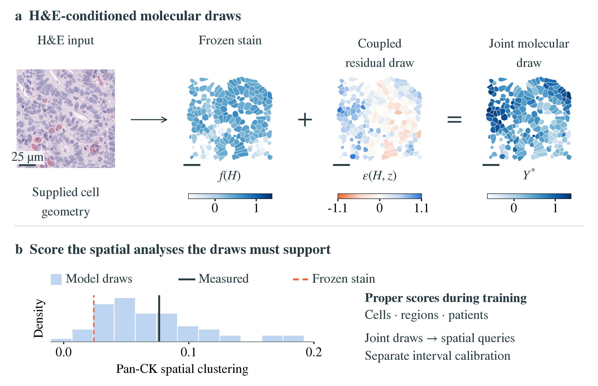

# LIGATURE

**Generative Inference of Spatial Molecular Organization from Histology**

LIGATURE adds a morphology-conditioned joint residual model to a frozen per-cell
virtual stain. Multiscale spatial fields and shared region/patient latent variables
model dependence between molecular measurements. Training scores cell measurements,
region-level spatial statistics and patient summaries using CRPS. The resulting
joint samples support spatial analyses, including queries absent from training.



Samples are realizations of the fitted model. The evaluation concerns spatial
statistics, conditional on the stated geometry and measurement definitions.
Prediction intervals require calibration on separately measured patients.

## Paper

- [Main manuscript](paper/submission/ligature_recomb2027.pdf)
- [Supplementary material](paper/submission/ligature_recomb2027_supplement.pdf)
- [LaTeX source](paper/main.tex)

The paper distinguishes reference evaluations, independent calibration and
exploratory simple baselines. All reported comparators, including those favoring
direct predictors, remain in the tables. The lung study is a separately trained
cohort evaluation. See the paper for the interpretation and limitations of each
comparison.

## Install and run a data-free example

Use Python 3.11. From this repository's root:

```bash
python3.11 -m venv .venv
source .venv/bin/activate
python -m pip install --upgrade pip
python -m pip install -r release/ligature/requirements.txt
python examples/synthetic.py
```

The synthetic example exercises joint draws, shared patient latents, analytic
bilinear means and differentiable spatial scoring. It needs no downloads, patient
data or fitted checkpoints. It is an execution example, not a trained result.

Additional data-free checks exercise conformal ranks, analytic moments, the
complete-fold evaluator and the independent-cell marginal control:

```bash
python research/calibration/test_numerics.py
python research/query_bench_20261104/check_analytic.py
python research/query_bench_20261104/check_evaluation.py
python research/query_bench_20261104/check_marginal.py
```

For a platform-specific PyTorch build, install the appropriate torch/torchvision
packages before the remaining requirements. Feature extraction benefits from a
GPU; model fitting and statistical evaluation support CPU execution. Dependency
versions are those used for the implementation. A fresh full installation and full
cohort retraining are separate from the included synthetic checks.

## Reproduce the experiments

The [core instructions](release/ligature/README.md) cover ORION preprocessing,
the five reference rotations, the frozen stain and generator, contact/neighborhood
queries, direct baselines, ablations and the lung cohort. All launches use Python
entry points.

The [additional benchmark instructions](research/query_bench_20261104/README.md)
cover independently calibrated three-seed comparisons, new spatial queries,
analytic inference and the H&E-derived geometry control. The required calibration
fits are implemented in [research/calibration](research/calibration/README.md).
The fixed-model mask-distance sensitivity is in
[research/segmentation_control](research/segmentation_control/README.md).
The final exploratory no-image, additive-correction and ridge comparisons are in
[research/simple_baselines](research/simple_baselines/README.md).

The code uses one model source tree: `release/ligature/src/`. Experiment preparation
creates source snapshots and fitted outputs in the chosen data workspace. Raw
data, pretrained/fitted weights and patient-level prediction files are downloaded
or generated locally. Only aggregate benchmark summaries are included here.

## Rebuild the paper and result plots

From `paper/`, use a LaTeX installation with the packages declared in `main.tex`:

```bash
tectonic main.tex
```

This builds the combined manuscript, bibliography and appendix. The submission
PDFs are also supplied above. The eight final figure PDFs/PNGs are included.
The two aggregate benchmark plots and their tables can be regenerated without
patient data:

```bash
python research/simple_baselines/render_numbers.py
python research/query_bench_20261104/render_tables.py
python research/query_bench_20261104/render_figures.py
```

The tissue overview is supplied as a final figure export; its original image
inputs and trained forecasts are not bundled as an example dataset. Reference-run
figure scripts in `release/ligature/src/` require the corresponding regenerated
experiment outputs.

## License and data attribution

Original software and software documentation are released under the
[MIT License](LICENSE), copyright 2026 Adhiban Arulselvan. Dataset, pretrained-model
and derived-image terms remain separate; see [third-party notices](THIRD_PARTY_NOTICES.md).

ORION-CRC is distributed under CC BY 4.0 and attributed to Lin et al., *Nature
Cancer* (2023), with the crop release provided by csmp-hub. HEST-1k access requires
accepting its dataset terms. Phikon-v2 has its own model license. No rights to
third-party datasets or model weights are granted by this repository's MIT license.

## Author and citation

[Adhiban Arulselvan](https://github.com/ark248), Massachusetts Institute of
Technology, Computer Science and Artificial Intelligence Laboratory (CSAIL).

Please cite the manuscript using its title and author information. Machine-readable
software citation metadata is in [CITATION.cff](CITATION.cff).
