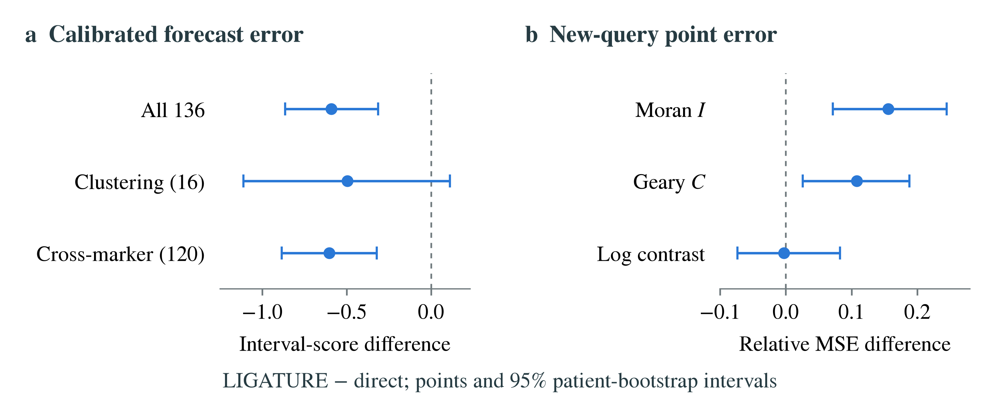

<div align="center">

# Generative Inference of Spatial Molecular Organization from Histology

**LIGATURE · Joint molecular sampling for spatial tissue analysis**

[Adhiban Arulselvan](https://openreview.net/profile?id=~Adhiban_Arulselvan1)<br>
MIT CSAIL

[**Paper**](paper/submission/ligature_recomb2027.pdf) · [**Supplement**](paper/submission/ligature_recomb2027_supplement.pdf) · [**Results**](#results) · [**Reproduce**](#reproduce) · [**Citation**](#citation)

</div>

<p align="center">
  
</p>

**Accurate cell predictions do not guarantee accurate spatial statistics.**
Virtual stains predict molecular measurements from routine histology, but immune
co-localization and molecular clustering depend on relationships between cells.
Per-cell prediction objectives alone do not identify those relationships.

This repository accompanies *LIGATURE: Generative Inference of Spatial Molecular
Organization from Histology*. LIGATURE preserves a frozen virtual stain and learns
a morphology-conditioned joint residual model. Training scores the spatial
statistics used in tissue analysis, and the resulting molecular samples support
both those statistics and additional queries.

<sub>The overview shows original H&E and supplied cell segmentations from one
held-out ORION crop. The molecular map is one model draw; the histogram summarizes
64 draws. This is an illustration, not an aggregate accuracy or calibrated-coverage
result.</sub>

## What the paper establishes

- **Characterize the missing dependence.** Conditional-mean predictions omit
  residual covariance from bilinear spatial statistics. Even exact per-cell
  marginals leave these expectations unidentified; semidefinite bounds quantify
  the Gaussian-marginal identification interval.
- **Learn against spatial analyses.** Morphology-conditioned multiscale fields
  and shared region/patient latents couple cell measurements. CRPS scores cell
  measurements, region statistics and patient summaries around the frozen stain.
- **Evaluate patient-level forecasts.** Separate training, selection, calibration
  and test patients allow matched comparisons of calibrated predictive intervals.
  Raw sample quantiles are not calibrated by themselves.
- **Test reuse beyond the loss.** Joint samples answer gated contacts and
  neighborhood queries absent from generator training. Direct predictors remain
  competitive, and are better on some newly introduced queries.

For two cells' molecular measurements, the central distinction is:

$$
\mathbb{E}[Y_iY_j\mid H]
=\mathbb{E}[Y_i\mid H]\,\mathbb{E}[Y_j\mid H]
+\operatorname{Cov}(Y_i,Y_j\mid H).
$$

Per-cell conditional means supply the product term; spatial inference also needs
the residual covariance. The evaluation targets selected spatial statistics,
conditional on the stated cell geometry and intensity scale. Samples are model
realizations, rather than recovery of a unique molecular arrangement.

## Results

### Patient-level forecasts under independent calibration

<p align="center">
  
</p>

**ORION-CRC · 40 patients · three seeds · five patient-disjoint rotations.** Each
rotation uses 20 training, 2 selection, 10 calibration and 8 test patients. All
methods use the same calibration patients. MSE is relative to this protocol's
frozen-stain plug-in; interval score and width use training-patient standard
deviations. Lower MSE and interval score are better.

| Method | Interval construction | MSE / stain | 90% coverage | Interval score |
| :--- | :--- | ---: | ---: | ---: |
| Frozen stain | Constant scale | 1.00 | 91.5% | 5.89 |
| Stain + per-statistic constant | Constant scale | 1.01 | 90.9% | 5.58 |
| Stain-context ridge | Constant scale | 1.03 | 90.9% | 5.80 |
| Matched direct graph | Adaptive scale | 0.96 | 90.9% | 5.57 |
| **LIGATURE** | **Adaptive scale** | **0.95** | **90.5%** | **4.98** |
| LIGATURE | Constant scale | 0.95 | 91.1% | 5.67 |

LIGATURE's overall calibrated interval score is **10.6% below the matched direct
graph's** (paired conditional 95% difference interval: −0.87 to −0.31). Point-error
and clustering-interval comparisons are inconclusive. The overall forecast
comparison is exploratory and largely driven by cross-marker statistics; the
additive and ridge controls were added post hoc. Metrics average runs rather
than ensemble their predictions.

### Recovering spatial molecular statistics

In the **40-patient ORION reference evaluation**, median attenuation of
non-negligible cohort means falls from **34% to 6%**. Same-marker attenuation falls
from **58% to 5%**, and clustering MSE is **40% lower than the frozen stain's**
(39% across four generator runs). These results concern contrasts in
training-standardized log intensities; improvements are smaller on the original
log-assay scale.

Simple corrections account for much of the bias reduction. The direct graph also
has lower overall point error in the multi-run reference comparison: **0.88 versus
0.91** for LIGATURE, each relative to the stain. The paper distinguishes this
reference protocol from independent calibration above.

In a **separate 19-patient lung Xenium evaluation**, LIGATURE reaches MSE ratios
of **0.84 overall and 0.48 for clustering** relative to that cohort's stain. The
stain-conditioned direct graph reaches 0.82 and 0.49. Models are refitted within
the lung cohort; this is not frozen cross-cohort deployment.

### Queries absent from generator training

For gated contact fractions, LIGATURE has **30% lower MSE than a quantile-matched
stain** in the reference evaluation. With validation-based quantile gates
(LIGATURE-Q), an exploratory **CD8a–epithelial proximity** case has **26% lower
MSE than the contact-trained direct graph** (unadjusted paired 95% ratio interval:
0.559–0.916; four generator runs and three direct seeds).

These gates are marker-based proxies: Pan-CK marks epithelium, not specifically
tumor. The single-query result does not imply an advantage over direct prediction
across the contact family. Adapted direct and ridge predictors outperform frozen
joint samples on the new Moran's I and Geary's C queries. Exploratory survival and
pathology analyses do not establish clinical superiority.

See the [paper](paper/submission/ligature_recomb2027.pdf) and
[supplement](paper/submission/ligature_recomb2027_supplement.pdf) for complete
comparisons, the H&E-derived geometry control, ablations and limitations. Numeric
tables are generated from the included aggregate results; patient-level outputs
are not bundled.

Aggregate summaries: [matched benchmarks](research/query_bench_20261104/results/summary.json),
[biological case](paper/biological_case.json), and
[clinical sensitivities](paper/clinical_feasibility.json).

## Reproduce

### Install and run a data-free example

Use Python 3.11. From this repository's root:

```bash
python3.11 -m venv .venv
source .venv/bin/activate
python -m pip install --upgrade pip
python -m pip install -r release/ligature/requirements.txt
python examples/synthetic.py
```

The example exercises joint draws, shared patient latents, analytic bilinear
means and differentiable spatial scoring. It needs no downloads, patient data or
fitted checkpoints. It is an execution example, not a trained result.

For a platform-specific PyTorch build, install the appropriate torch/torchvision
packages before the remaining requirements. Feature extraction benefits from a
GPU; fitting and statistical evaluation support CPU execution. A clean full
installation and cohort retraining are separate from the included checks.

### Build the paper

Install Tectonic, then run from the repository root:

```bash
python -m pip install pypdf
cd paper
tectonic main.tex
python split_submission.py
cd ..
```

The split produces `paper/submission/ligature_recomb2027.pdf` and
`paper/submission/ligature_recomb2027_supplement.pdf`. The main submission has
**one title page, ten body pages and two bibliography pages**; the separate
supplement has **24 pages**. Required TeX inputs and final figure exports are
included, so building the paper needs no model inference or patient downloads.

### Regenerate aggregate tables and result plots

From the repository root, using the installed Python environment:

```bash
python research/simple_baselines/render_numbers.py
python research/query_bench_20261104/render_tables.py
python research/query_bench_20261104/render_figures.py
python release/ligature/src/render_biological_case.py \
  --summary paper/biological_case.json \
  --feasibility paper/clinical_feasibility.json --paper-dir paper
```

These commands read included aggregate summaries. The tissue overview is supplied
as a final export; regenerating its underlying maps requires the original image
inputs and trained forecasts. Reference-run figure scripts in
`release/ligature/src/` similarly require regenerated experiment outputs.

### Check the statistical and sampling implementation

```bash
python research/calibration/test_numerics.py
python research/query_bench_20261104/check_analytic.py
python research/query_bench_20261104/check_evaluation.py
python research/query_bench_20261104/check_marginal.py
```

These data-free checks cover conformal ranks, analytic moments, the complete-fold
evaluator and the independent-cell marginal control. They supplement the
manuscript's arguments and empirical evaluations.

### Re-run the experiments

| Evaluation | Instructions |
| :--- | :--- |
| ORION preprocessing, reference rotations, stains and residual models | [Core implementation](release/ligature/README.md) |
| Independent calibration and external/unscored-query extensions | [Calibration](research/calibration/README.md) |
| Matched forecasts, new queries and H&E-derived geometry | [Additional benchmarks](research/query_bench_20261104/README.md) |
| Fixed-model non-touching-pair sensitivity | [Segmentation control](research/segmentation_control/README.md) |
| No-image, additive-correction and ridge comparisons | [Simple baselines](research/simple_baselines/README.md) |
| CD8a–epithelial proximity and exploratory clinical checks | [Case reproduction](release/ligature/README.md#cd8aepithelial-proximity-case) |

The code uses one model source tree, `release/ligature/src/`. Data preparation
creates source snapshots and fitted outputs in the chosen workspace. Full
reanalysis requires separately obtained datasets and pretrained models, followed
by local generation of embeddings, fits and patient-level predictions.

## Figures

| Figure | Preview / vector | Reproduction |
| :--- | :--- | :--- |
| Tissue-space method overview | [PNG](paper/fig_overview.png) · [PDF](paper/fig_overview.pdf) | Final export; underlying image/forecast inputs are not bundled |
| Matched forecast and query comparisons | [PNG](paper/fig_benchmarks.png) · [PDF](paper/fig_benchmarks.pdf) | [Aggregate renderer](research/query_bench_20261104/render_figures.py) |
| H&E-derived geometry control | [PNG](paper/fig_geometry.png) · [PDF](paper/fig_geometry.pdf) | [Aggregate renderer](research/query_bench_20261104/render_figures.py) |

Five additional reference-run figure PDF/PNG pairs are included with the
supplement. Their scripts and input requirements are in the core implementation.

## Repository layout

```text
release/ligature/                Core model, preprocessing and external-cohort tools
research/calibration/            Independent patient-level calibration
research/query_bench_20261104/   Matched forecasts, query reuse and H&E geometry
research/segmentation_control/   Fixed-model mask-distance sensitivity
research/simple_baselines/       Exploratory simple-comparator evaluation
paper/                           Manuscript, bibliography, tables, figures and PDFs
examples/synthetic.py            Data-free execution example
```

## License and data attribution

Original software and software documentation are released under the
[MIT License](LICENSE), copyright 2026 Adhiban Arulselvan. Dataset, pretrained-model
and derived-image terms remain separate; see [third-party notices](THIRD_PARTY_NOTICES.md).

ORION-CRC is distributed under CC BY 4.0 and attributed to Lin et al., *Nature
Cancer* (2023), with the crop release provided by csmp-hub. HEST-1k requires
accepting its dataset terms. Phikon-v2 and the other pretrained models retain
their upstream licenses. No rights to third-party datasets or model weights are
granted by this repository's MIT license.

## Citation

Please cite the manuscript when using this work:

```bibtex
@misc{arulselvan2026ligature,
  title        = {{LIGATURE}: Generative Inference of Spatial Molecular Organization from Histology},
  author       = {Arulselvan, Adhiban},
  year         = {2026},
  howpublished = {Manuscript},
  url          = {https://github.com/ark248/LIGATURE}
}
```

Machine-readable software citation metadata is available in [CITATION.cff](CITATION.cff).
